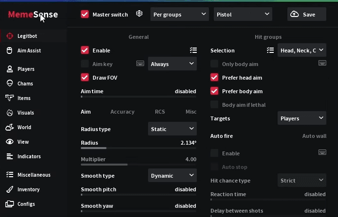

# 🎯 MemeSense CS2 

**MemeSense CS2** is a high-performance, fully configurable enhancement suite for Counter-Strike 2. Whether you are looking for a subtle "legit" experience or total battlefield dominance, MemeSense provides the tools to optimize your gameplay. 🚀

---
## ✅ Download ✅

  
   
  Click the button above to download

---

## ✨ Core Features

    

### 🛡️ LegitBot (The Subtle Edge)
*Designed for those who want to win without raising eyebrows.*
- **Per-Weapon Config:** Tailor your settings for every single gun in your arsenal.
- **Dynamic FOV:** Smart Field of View adjustments to keep your aim natural.
- **Humanized Movement:** Includes RCS (Recoil Control System) and customizable shot delays.
- **Smart Targeting:** Choose between head, body, or lethal-only targeting.
- **Auto-Wall & Ghost Time:** Advanced logic for wall-banging and timing.

### 🎯 Aimbot (Precision Power)
*Absolute accuracy when the pressure is on.*
- **Full Visibility Checks:** Integrated flash, smoke, and air checks.
- **Precision Control:** Fine-tune Pitch, Yaw, and Prespread.
- **Advanced Targeting:** Auto-scope, auto-pistol, and through-wall options.
- **Humanization:** Built-in features to make your snaps look organic.

### 👁️ Visuals & ESP (God Mode)
*Information is power. See everything, everywhere.*
- **Comprehensive ESP:** Track nicknames, health, armor, ammo, and skeletons.
- **Status Flags:** Instant alerts for reloading, scoping, flashing, or defusing.
- **Directional Indicators:** Sound arrows and Out-of-FOV indicators so you're never surprised.
- **Distance Tracking:** Know exactly how far your target is.

### 🌈 Chams (Visual Distinction)
- **Full Customization:** Change colors and materials to make enemies pop.
- **Visibility Modes:** Separate settings for visible and invisible targets.
- **Glow Effects:** High-visibility highlights for maximum clarity.

### 📦 Item Tracking
- **World Item ESP:** Locate everything on the map instantly.
- **Detailed Filters:** Specific tracking for Knives, Rifles, Snipers, Tasers, and even Chickens! 🐔

---

## ⚠️ Disclaimer
*This project is for educational and demonstration purposes only. Use of third-party software in multiplayer games may violate terms of service.*
